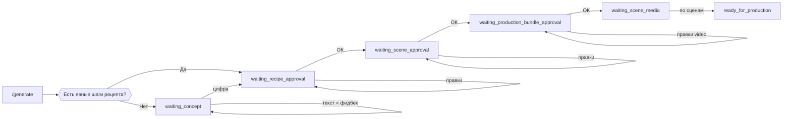

# Пайплайн генерации контента (Content Fabric Bot)

Документ описывает **полный путь данных** от команды пользователя в Telegram до готового production JSON и изображений по сценам: какие модули участвуют, в каком порядке вызывается Gemini, какие правила навязаны на каждом этапе и как устроена отказоустойчивость.

---

## 1. Назначение

Пайплайн превращает **идею блюда** (или готовый рецепт пользователя) в:

1. **Концепты** вирусного контента (опционально).
2. **Шаги рецепта** (4–6 конкретных действий).
3. **Сценарий сцен** строго «1 шаг = 1 сцена» с персонажами, `continuity_anchors`, репликами под Veo3.
4. **Viral Retention Layer**: перед сценами формируется `Viral Concept Brief` — главный хук, обещание зрителю, причина досмотреть, первый кадр, payoff, 10+ хуков и мягкий план рекламной интеграции.
5. **Production-пакет** (один LLM-вызов): стартовый и конечный промпты кадра **и** `video_prompt` по сценам; **один апрув** всего блока перед медиа.
5. **Поштучная генерация** (Vertex): изображения и видео по сценам с апрувом.

Между этапами пользователь подтверждает результат («ОК») или присылает правки; состояние диалога хранится в памяти процесса (`SESSIONS[chat_id]`).

**Ключевые исходники кода:**

| Роль | Файл |
|------|------|
| Точка входа процесса | `main.py` |
| Регистрация команд Telegram | `app/bot_app.py` |
| State machine и UX | `app/handlers.py` |
| Этапы LLM: концепты → рецепт → viral brief → сцены → frames → production | `app/pipeline.py` |
| Валидация и нормализация сцен | `app/scene_utils.py` |
| Viral Retention Layer и analytics feedback | `app/viral_retention.py`, `app/analytics_feedback.py` |
| Вызовы Gemini (Vertex AI или API key), ретраи | `app/llm_utils.py` |
| Очередь LLM | `app/llm_queue.py` |
| Кэш промежуточных ответов | `app/cache.py` |
| Состояния диалога | `app/constants.py`, `app/state.py` |

---

## 2. Запуск приложения

1. `load_env_file()` подмешивает переменные из `.env` в `os.environ`.
2. Читается `TELEGRAM_BOT_TOKEN` — без него бот не стартует.
3. `build_application(token)` собирает `telegram.ext.Application`: команды и общий обработчик текста.
4. `run_polling()` — long polling к API Telegram.

Бизнес-логика генерации **не** живёт в `main.py`; она в `app/pipeline.py` и вызывается из `handlers.py`.

---

## 3. Диаграмма состояний (state machine)

Состояние хранится в `session["state"]` и соответствует константам из `app/constants.py`.

**Состояния-заглушки** (`refining_concept`, `refining_recipe`, `refining_scenes`, `refining_frame_prompts`) нужны, чтобы не обрабатывать гонку сообщений, пока идёт долгий LLM-запрос: пользователю показывается подсказка подождать.

**Debounce:** для обычного текста используется пауза ~1.5 с; обрабатывается только «последнее» сообщение после паузы (`handlers.py`).

---

## 4. Обзор этапов пайплайна (данные)

### 4.1. Старт: `/generate <текст>`

- Если в тексте **распознано минимум 2 шага рецепта** (и это не заглушка вроде одной строки «подготовить ингредиенты»), этап **концептов пропускается**: состояние сразу `waiting_recipe_approval`, шаги нормализуются до 4–6 без вызова LLM для концептов.
- Иначе вызывается `generate_recipe_concepts()` → 3–5 концептов, состояние `waiting_concept`.

### 4.2. Концепты (`generate_recipe_concepts`)

- Вход: идея пользователя; опционально фидбек и предыдущие концепты при итерации.
- Выход: `{"concepts": [...], "text_plan": "..."}` — JSON с полями `name`, `why`, `hook` и отформатированный текст для Telegram.
- Кэш: `cache.get_concepts` / `set_concepts` по `(idea, feedback, previous)`.
- При «битом» JSON от модели — один проход «починки» через отдельный промпт.
- Эвристика: короткий ввод (≤6 слов) трактуется как **конкретное блюдо** — первый концепт может принудительно включать название из запроса.

### 4.3. Шаги рецепта (`generate_recipe_steps`)

- Вход: текст выбранного концепта, имя блюда, опционально фидбек и предыдущие шаги.
- LLM возвращает строки вида `ШАГ N: ...`; парсинг через `extract_recipe_steps_text` + `normalize_recipe_steps`.
- Если шагов **меньше 4** — `expand_recipe_steps`; если **больше 6** — `merge_recipe_steps`; затем `_ensure_recipe_steps_len` и при необходимости `_enrich_recipe_steps_if_needed` (улучшение слишком коротких/общих шагов).
- Кэш: `get_recipe_steps` / `set_recipe_steps`.

### 4.4. План сцен (`generate_scenes_plan`)

- **Инвариант:** число сцен **строго равно** числу шагов рецепта; один шаг — одна сцена.
- В промпт передаётся только character-часть `ASSETS`; location-ассеты и поля `location` не уходят в LLM. Консистентность держится через `continuity_anchors` и `continuity_state`.
- После ответа модели: `extract_json_array` → `normalize_scenes_for_pipeline` → обрезка/дополнение до длины `recipe_steps` → **`_postprocess_scenes_output`** (привязка `recipe_step`, контракт первой/последней сцены, русский `action`, `apply_veo3_speech_format`).
- **Валидация:** `scenes_quality_errors`, `scenes_follow_recipe_steps`, `has_banned_scene_phrases`. При ошибках: сначала **`fix_scenes`** (точечное исправление JSON), при неудаче — до 3 попыток с перегенерацией и усиленным промптом. События попыток попадают в `regeneration_events` для отчёта пользователю.
- Кэш: `get_scenes_plan` / `set_scenes_plan` по `(concept, recipe_steps, feedback)`.

### 4.5. Production (`generate_full_production`)

- После «ОК» по сценарию вызывается с **`approved_frame_prompts=None`**: один запрос к LLM, массив `prompts` с `start_frame_prompt_ru`, `end_frame_prompt_ru`, `video_prompt_en` на сцену.
- Если заданы **`approved_frame_prompts`** (срез кадров из предыдущего production при правках только video): старт/энд фиксированы, LLM переписывает только `video_prompt_en`.
- На выходе: `start_frame_prompt`, `end_frame_prompt`, `video_prompt`, `model`, заглушка `tts`. `voice_lock_full` в `video_prompt` при необходимости — см. `_finalize_scene_video_prompt`.
- Функция `generate_frame_prompts_for_approval` остаётся в коде для старых сессий / отладки; основной UX её не использует.

### 4.6. Генерация изображений и видео (после апрува production)

- Для каждой сцены по очереди: показ промпта, варианты «ОК», `ПРОМПТ: ...`, `ФИДБЕК: ...`.
- Картинка: `vertex_images.generate_image_vertex` в потоке (`asyncio.to_thread`), опционально с **референсом** из `scene["references"]` (`_load_scene_reference_image`).
- При ошибке — повтор с **смягчённым** промптом (`_soften_generation_prompt`).
- Если задан конечный кадр — вторая генерация с референсом на стартовый PNG.

---

## 5. Вызовы Gemini и блокировка event loop

- Все синхронные вызовы Gemini в `pipeline.py` оборачиваются в **`asyncio.to_thread(gemini_generate_sync, ...)`**, чтобы не блокировать цикл `python-telegram-bot`.
- `gemini_generate_sync` внутри использует **`safe_llm_call`** → глобальная очередь **`submit_llm`** (последовательность запросов, троттлинг).

### 5.1. Ретраи на уровне handlers

Для операций пайплайна используется **`_call_with_503_retries`**: при `503` / `unavailable` / `high demand` — до **20** повторов с паузой **15** секунд и сообщением пользователю.

### 5.2. Поведение `llm_utils` (кратко)

- **Квота исчерпана** (`quotaValue`, `RESOURCE_EXHAUSTED`): без бессмысленных ретраев → `GeminiQuotaError` и дружелюбное сообщение в Telegram.
- **429 / rate limit:** backoff с джиттером; при необходимости — fallback-модели.
- Все запросы Gemini выполняются через Vertex SDK transport.
    `GEMINI_API_KEY` -> `GEMINI_API_KEYS` -> `VERTEX_API_KEY`.
- Разбор «грязного» JSON: `extract_json_object`, `extract_json_array`.

---

## 6. Правила сцен (enforcement)

Закреплены в промптах и проверяются в `scene_utils` + постобработкой в `pipeline.py`:

| Правило | Смысл |
|--------|--------|
| 1 шаг рецепта = 1 сцена | Нет пропусков и слияний шагов |
| Персонажи | Бабушка и кот; реплики в `text` |
| Опоры консистентности | `continuity_anchors`: посуда, кастрюля/сковорода, плита/поверхность, ингредиенты, состояние еды |
| Плита/сковорода | При явной готовке на плите поле `stove_burner`: одна из четырёх конфорок |
| Нарезка | Явный стиль нарезки |
| Финал | Подача/презентация блюда, при необходимости `dish_description` |
| Межсценовый переход | Каждая новая сцена меняет ракурс или предметный фокус, сохраняя нужные `continuity_anchors` |
| Запрет ракурса | Запрещён `low angle` / `from below` |
| Veo3 / `veo3_fast` | Длительность только 4, 6 или 8 сек; реплика без пунктуации, паузы `[пауза]`, ударения заглавной гласной |
| Запрещённые абстракции | Например «готовит», «что-то делает» — триггер валидации |

Дополнительно: **`_enforce_first_last_scene_contract`** — первая сцена явно говорит *что готовим*, последняя — *презентация результата*.

---

## 7. Кэш

`app/cache.py` — **in-memory** словари с ключом SHA256 от нормализованных аргументов:

- концепты;
- шаги рецепта;
- план сцен.

При смене фидбека или шагов ключ меняется — повторный запрос не берёт устаревший кэш. После перезапуска процесса кэш пуст.

---

## 8. Вспомогательные команды (не основной пайплайн)

| Команда | Назначение |
|---------|------------|
| `/image <промпт>` | Одно изображение по тексту без сценария |
| `/fix_stress` | Локальная нормализация ударений/`[пауза]` в уже загруженных сценах сессии |
| `/cancel`, `/reset` | Сброс `SESSIONS[chat_id]` |
| `/check_env` | Диагностика переменных окружения (секреты маскируются) |

---

## 9. Упрощённый путь в коде

`generate_script(text)` в `pipeline.py` — **одношаговый** сценарий для отладки: `generate_recipe_steps` → `generate_scenes_plan` без Telegram state machine. Основной UX идёт через `handlers.py`.

---

## 10. Зависимости окружения (сводка)

- **Обязательно:** `TELEGRAM_BOT_TOKEN` и один из вариантов Gemini-доступа:
  - API key: `GEMINI_API_KEY` / `GEMINI_API_KEYS` (или `VERTEX_API_KEY` как fallback-ключ).
- **Рекомендуется:** `GEMINI_MODEL`, `GEMINI_MODEL_FALLBACKS` для устойчивости.
- **Изображения Vertex:** `VERTEX_API_KEY`, `GOOGLE_CLOUD_PROJECT`, `GOOGLE_CLOUD_LOCATION`, модели см. `README.md`.
- **ElevenLabs (если сцены с `voice_provider: elevenlabs`):** `ELEVENLABS_VOICE_ID` и связанные ключи — иначе возможны заглушки в payload озвучки.

---

Этот файл можно держать рядом с кодом как **единый источник правды** по этапам пайплайна; при изменении логики в `pipeline.py` или `handlers.py` имеет смысл обновлять соответствующие разделы.
