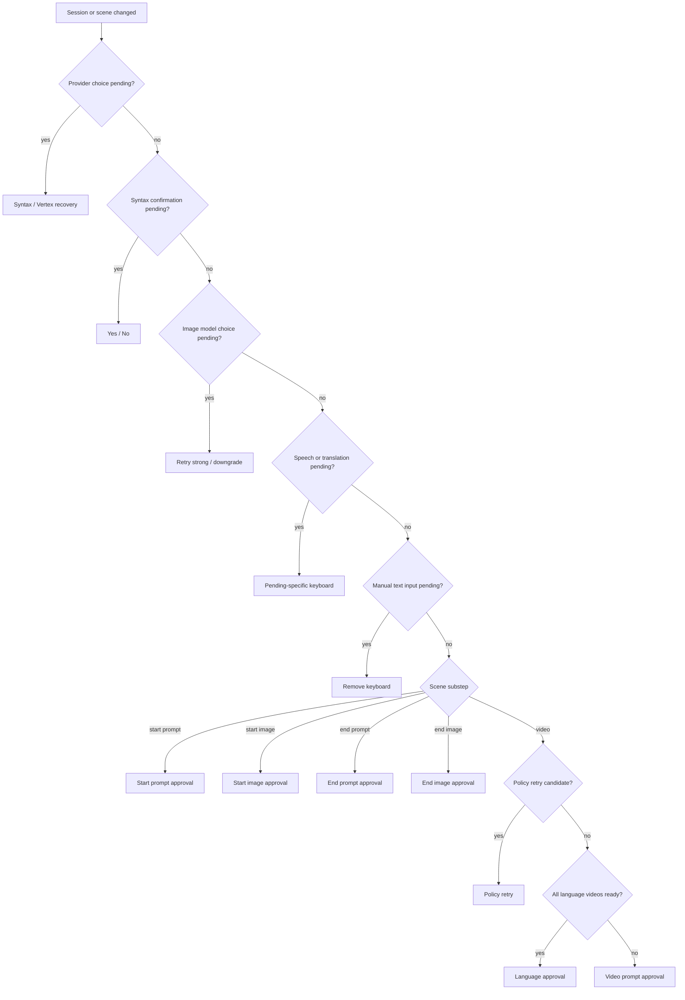
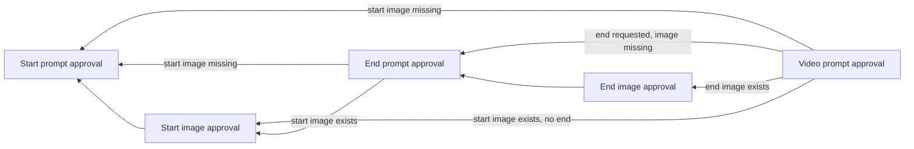

# Scene-media keyboard state machine

The executable contract is
[`scene_media_keyboard_schema.json`](./scene_media_keyboard_schema.json).
The keyboard is derived from persisted `session` and current scene data by
`scene_media_keyboard_snapshot()`. Pending decisions always override the base
`scene_media_substep`.

## Mandatory change workflow

Any change to a scene-media state, keyboard builder, button text, row order, or
provider recovery transition must:

1. Review this complete state machine, not only the edited handler.
2. Update the exact affected rows in `scene_media_keyboard_schema.json`.
3. Update provider transitions in the schema when control flow changes.
4. Update or add transition tests for success, partial success, and errors.
5. Run the full test suite.

`test_scene_media_keyboard_snapshot_covers_each_visible_state` compares every
registered state and every button row exactly. A new state, removed state,
renamed button, or changed row order fails until the schema is reviewed and
updated. `test_scene_media_keyboard_schema_covers_dynamic_variants` applies the
same exact comparison to single-language, auto-approval, model-upgrade, and
policy-retry variants.

## Previous-step transitions

`Предыдущий шаг` returns to the previous screen that actually existed. Generated
images are not skipped during reverse navigation.

| Current state | Previous state |
| --- | --- |
| `scene_media.video.prompt` | `scene_media.end.image_approval` when the requested end image exists |
| `scene_media.video.prompt` | `scene_media.end.prompt` when an end frame is requested but not generated |
| `scene_media.video.prompt` | `scene_media.start.image_approval` when only the start image exists |
| `scene_media.video.prompt` | `scene_media.start.prompt` when no start image exists |
| `scene_media.end.image_approval` | `scene_media.end.prompt` |
| `scene_media.end.prompt` | `scene_media.start.image_approval` when the start image exists, otherwise `scene_media.start.prompt` |
| `scene_media.start.image_approval` | `scene_media.start.prompt` |

## Visible states

| State | Required controls |
| --- | --- |
| `scene_media.start.prompt` | OK, approval mode, end-frame choice, prompt, feedback, restart |
| `scene_media.start.image_approval` | OK, approval mode, prompt, edit, feedback, regenerate, optional end-frame/model choice |
| `scene_media.end.prompt` | OK, approval mode, prompt, feedback, restart |
| `scene_media.end.image_approval` | OK, approval mode, prompt, edit, feedback, regenerate, optional model choice |
| `scene_media.video.prompt` | OK, approval mode, speed, prompt, feedback, phrase, frame restarts |
| `scene_media.video.provider_choice` | Syntax, Vertex, feedback, prompt/phrase per missing language, navigation |
| `scene_media.video.syntax_confirmation` | yes, no, navigation |
| `scene_media.image.model_choice` | retry strong, optional downgrade, navigation |
| `scene_media.video.speech.*` | retry/wait, approve/edit, or keep/shorten/edit according to stage |
| `scene_media.video.translation.*` | yes/no or feedback/phrase according to stage |
| `scene_media.input.*` | keyboard removed while free-form text is expected |
| `scene_media.video.policy_retry` | OK, prompt, format, feedback, optional start restart |
| `scene_media.video.language_approval` | approve all/per language, speed, feedback, prompt/phrase/regenerate per language |
| `scene_media.complete` | first-step menu |

## Provider recovery transitions

| Event | State after event |
| --- | --- |
| Syntax/Vertex returns every missing video | clear `video_provider_choice_pending`; show language approval or advance |
| Syntax/Vertex returns only some videos | keep pending only for missing languages; redraw recovery keyboard |
| Syntax/Vertex raises an error | keep pending payload; redraw recovery keyboard |
| User edits prompt, phrase, or feedback | refresh pending payload; keep recovery keyboard |
| User sends unrelated text | keep state; redraw recovery keyboard |

The regression tests assert the visible-state matrix and successful, partial,
and failed provider transitions. In particular, a successful recovery must not
leave `Syntax` or `Vertex` in the next keyboard.
